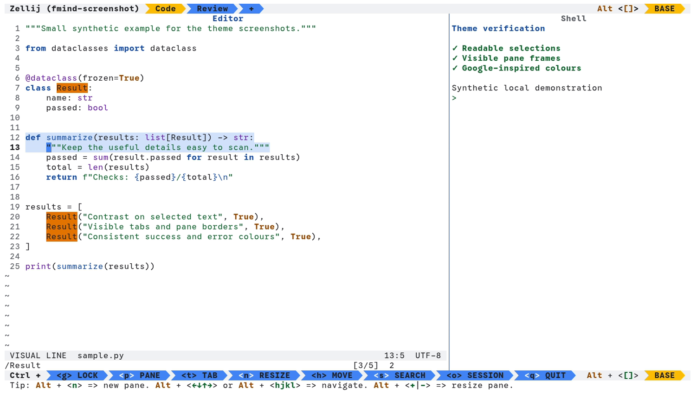
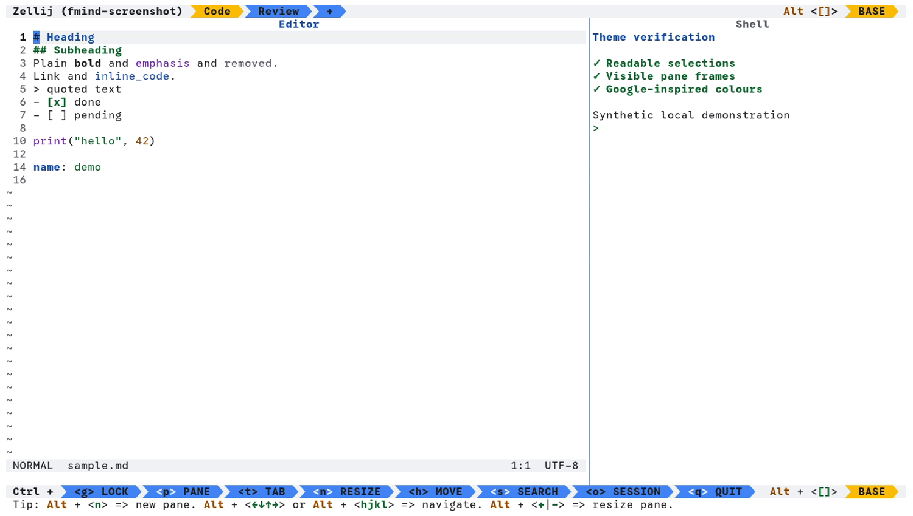
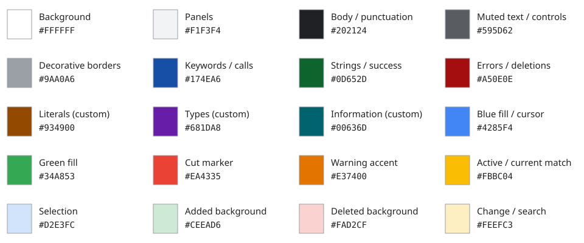

# fmind/theme

A light theme for code, terminals and apps, and the Fmind design system. Native files live in one folder per app under `themes/`; [DESIGN.md](DESIGN.md) describes the design for agents and design tools.

[Previews](#previews) · [Design system](#design-system) · [Palette](#palette) · [Themes](#available-themes) · [Contribute](#contribute)

[Changelog](CHANGELOG.md) · [Previous releases](https://github.com/fmind/theme/releases)

## Previews

| Code, shell, search and selection                    | Markdown                                        |
| ---------------------------------------------------- | ----------------------------------------------- |
|  |  |

Synthetic terminal captures made with VHS. Download [wallpapers](wallpapers/README.md) and [social banners](banners/README.md), or [preview all artwork](artworks/previews/all-variants.png).

## Design system

[DESIGN.md](DESIGN.md) is the single source for Fmind's visual identity: color roles, typography, layout, shapes, diagram components and do's and don'ts. It follows the [DESIGN.md format](https://github.com/google-labs-code/design.md) (alpha): YAML design tokens followed by prose rationale. Edit it here; consumers read it or export it instead of copying values.

It is the default for Médéric Hurier's own work. Customer or employer work uses that organization's design system, and an existing project keeps its established identity.

| Consumer                                                                    | How it uses DESIGN.md                                                                                                                                       |
| --------------------------------------------------------------------------- | ----------------------------------------------------------------------------------------------------------------------------------------------------------- |
| Coding agents (Antigravity, Claude Code, Copilot, OpenCode)                 | [fmind/dot](https://github.com/fmind/dot) deploys a checksummed copy to `~/.agents/DESIGN.md`, and its shared `AGENTS.md` persona points every agent to it. |
| A project repository                                                        | Copy DESIGN.md to the project root, where design-aware agents look for it, or link to `~/.agents/DESIGN.md` from the project's `AGENTS.md`.                 |
| [Google Stitch](https://stitch.withgoogle.com/docs/design-md/specification) | Provide DESIGN.md as the design system for generated UI; the format originates from Stitch.                                                                 |
| Tailwind CSS v4 or v3                                                       | `npx @google/design.md@0.4.0 export --format css-tailwind DESIGN.md` emits an `@theme` block; `--format json-tailwind` emits v3 `theme.extend` JSON.        |
| Figma variables, Style Dictionary, Tokens Studio                            | `npx @google/design.md@0.4.0 export --format dtcg DESIGN.md` emits [W3C Design Tokens](https://www.designtokens.org/) JSON.                                 |
| Plain CSS (Zensical, static sites)                                          | `npx @google/design.md@0.4.0 export --format css-vars --prefix fmind DESIGN.md` emits custom properties.                                                    |
| Diagrams, decks, illustrations and demos                                    | The `fmind-visuals` and `diagrams-as-code` skills in fmind/dot adapt the tokens to D2, Mermaid, SVG, Typst and VHS.                                         |
| Terminals, editors and apps                                                 | Use the native files under `themes/`; [palette.yaml](checks/palette.yaml) maps the same colors to syntax and ANSI roles.                                    |

Validate changes with `npx @google/design.md@0.4.0 lint DESIGN.md` (structure, references and WCAG contrast) and compare revisions with `npx @google/design.md@0.4.0 diff old.md DESIGN.md`. `mise run test` checks offline that the tokens match the palette and that component text meets 4.5:1.

## Palette

The palette uses the 15 [Google News hex colors](https://partnermarketinghub.withgoogle.com/brands/google-news/visual-identity/color-palette/) plus five complementary colors. Dark shades carry text, pale shades provide surfaces, and bright shades identify active states. Text stays upright; bold adds emphasis.

| Color                | Hex       | Syntax and text                             | Interface and backgrounds                                         |
| -------------------- | --------- | ------------------------------------------- | ----------------------------------------------------------------- |
| White                | `#FFFFFF` | Label text on dark fills                    | Main background                                                   |
| Light gray           | `#F1F3F4` | —                                           | Panels, cursor line and neutral diffs                             |
| Gray                 | `#9AA0A6` | —                                           | Decorative borders and separators                                 |
| Dark gray (custom)   | `#595D62` | Comments, gutter numbers and secondary text | Essential control borders and scrollbar thumbs; ANSI bright black |
| Charcoal             | `#202124` | Body text, variables and punctuation        | Labels on bright fills; ANSI black/white                          |
| Dark blue            | `#174EA6` | Keywords, functions, keys and headings      | Navigation and links; ANSI blue                                   |
| Medium blue          | `#4285F4` | —                                           | Cursor and active label fills                                     |
| Light blue           | `#D2E3FC` | —                                           | Selections, completions and inactive ribbons                      |
| Dark red             | `#A50E0E` | Errors and deleted text                     | Failures and deletions; ANSI red                                  |
| Medium red           | `#EA4335` | —                                           | Cut markers and error underlines                                  |
| Light red            | `#FAD2CF` | —                                           | Deletion backgrounds                                              |
| Dark orange (custom) | `#934900` | Numbers, constants and warnings             | Changes and attention; ANSI yellow                                |
| Orange               | `#E37400` | —                                           | Warning accents                                                   |
| Yellow               | `#FBBC04` | —                                           | Active tabs, current search matches and changed words             |
| Light yellow         | `#FEEFC3` | —                                           | Change backgrounds and ordinary search matches                    |
| Dark green           | `#0D652D` | Strings and added text                      | Success, additions and executables; ANSI green                    |
| Medium green         | `#34A853` | —                                           | Mode labels, copy markers and success accents                     |
| Light green          | `#CEEAD6` | —                                           | Addition backgrounds                                              |
| Purple (custom)      | `#681DA8` | Types, builtins, decorators and emphasis    | Secondary accents; ANSI magenta                                   |
| Teal (custom)        | `#00636D` | Informational diagnostics                   | Information and icons; ANSI cyan                                  |

## Available themes

Choose a tool for installation instructions and theme files. Each tool's README cites the upstream format its files follow. Some ports are partial, and inclusion here does not certify native application support.

- [Adminer](themes/adminer/)
- [Adobe](themes/adobe/)
- [Advent of Code](themes/adventofcode/)
- [aerc](themes/aerc/)
- [Alacritty](themes/alacritty/)
- [Albert](themes/albert/)
- [Alfred](themes/alfred/)
- [Aliucord](themes/aliucord/)
- [AlphaI TUI](themes/alphai-tui/)
- [Amfora](themes/amfora/)
- [Anytype](themes/anytype/)
- [Apache Superset](themes/superset/)
- [apt](themes/apt/)
- [Archive of Our Own](themes/archive-of-our-own/)
- [Arduino IDE](themes/arduino-ide/)
- [Atuin](themes/atuin/)
- [AutoAO3App](themes/auto-ao3-app/)
- [Base16](themes/base16/)
- [Bashtop](themes/bashtop/)
- [bat](themes/bat/)
- [BBEdit](themes/bbedit/)
- [Beamer](themes/beamer/)
- [Beeper](themes/beeper/)
- [bemenu](themes/bemenu/)
- [BetterCanvas](themes/bettercanvas/)
- [BetterDiscord](themes/betterdiscord/)
- [Beyond Compare 4](themes/beyond-compare-4/)
- [Blender](themes/blender/)
- [Blink Shell](themes/blink-shell/)
- [Blockbench](themes/blockbench/)
- [bobthefish](themes/bobthefish/)
- [bottom](themes/bottom/)
- [Brackets](themes/brackets/)
- [bspwm](themes/bspwm/)
- [BTCPay Server](themes/btcpay-server/)
- [btop](themes/btop/)
- [CadZinho](themes/cadzinho/)
- [Calibre](themes/calibre/)
- [Campfire](themes/campfire/)
- [Castero](themes/castero/)
- [Cava](themes/cava/)
- [Chatterino](themes/chatterino/)
- [Chrome](themes/chrome/)
- [Claude Code](themes/claude-code/)
- [Clone Hero](themes/clone-hero/)
- [Cmder](themes/cmder/)
- [Code::Blocks](themes/codeblocks/)
- [Codeforces](themes/codeforces/)
- [CodeRunner](themes/coderunner/)
- [colorls](themes/colorls/)
- [ColorSlurp](themes/color-slurp/)
- [ConEmu](themes/conemu/)
- [CopyQ](themes/copyq/)
- [COSMIC Terminal](themes/cosmic-terminal/)
- [CotEditor](themes/coteditor/)
- [Cursor](themes/cursor/)
- [Cutter](themes/cutter/)
- [DankMaterialShell](themes/dankmaterialshell/)
- [delta](themes/delta/)
- [Dev-C++](themes/dev-cpp/)
- [dircolors](themes/dircolors/)
- [Discourse](themes/discourse/)
- [Ditto](themes/ditto/)
- [Django Admin](themes/django-admin/)
- [dmenu](themes/dmenu/)
- [DOOM Emacs](themes/doom-emacs/)
- [Dracula CSS](themes/dracula-css/)
- [Drafts](themes/drafts/)
- [DuckDuckGo](themes/duckduckgo/)
- [Dunst](themes/dunst/)
- [Duolingo](themes/duolingo/)
- [Dwarf Fortress](themes/dwarf-fortress/)
- [Eclipse](themes/eclipse/)
- [EditPlus](themes/editplus/)
- [Emacs](themes/emacs/)
- [Evidence](themes/evidence/)
- [eza](themes/eza/)
- [Facebook](themes/facebook/)
- [Fastfetch](themes/fastfetch/)
- [Figma](themes/figma/)
- [Firefox](themes/firefox/)
- [Fish](themes/fish/)
- [Flarum](themes/flarum/)
- [Fluxbox](themes/fluxbox/)
- [FocusWriter](themes/focuswriter/)
- [FontForge](themes/fontforge/)
- [foot](themes/foot/)
- [Forgejo](themes/forgejo/)
- [FreeCAD](themes/freecad/)
- [FreshRSS](themes/freshrss/)
- [Fuzzel](themes/fuzzel/)
- [fzf](themes/fzf/)
- [Gajim](themes/gajim/)
- [GameMaker Studio](themes/gamemaker-studio/)
- [Geany](themes/geany/)
- [Gedit](themes/gedit/)
- [ggplot2](themes/ggplot2/)
- [gh-dash](themes/gh-dash/)
- [Ghostty](themes/ghostty/)
- [ghostwriter](themes/ghostwriter/)
- [GIMP](themes/gimp/)
- [Git](themes/git/)
- [GitHub](themes/github/)
- [GitHub Pages](themes/gh-pages/)
- [Gitk](themes/gitk/)
- [GitLab](themes/gitlab/)
- [GNOME Terminal](themes/gnome-terminal/)
- [GNU grep](themes/grep/)
- [GoAccess](themes/go-access/)
- [Godot](themes/godot/)
- [Google Search](themes/google-search/)
- [GRUB](themes/grub/)
- [GTK](themes/gtk/)
- [GtkSourceView](themes/gtksourceview/)
- [Hacker News](themes/hacker-news/)
- [Helix](themes/helix/)
- [Hermes Agent](themes/hermes-agent/)
- [Heroic Games Launcher](themes/heroic-games-launcher/)
- [highlight.js](themes/highlightjs/)
- [Home Assistant](themes/home-assistant/)
- [Homer](themes/homer/)
- [Hyper](themes/hyper/)
- [Hyprland](themes/hyprland/)
- [i3](themes/i3/)
- [i3lock-color](themes/i3lock-color/)
- [IDLE](themes/idle/)
- [Infinity for Reddit](themes/infinity-for-reddit/)
- [Inkscape](themes/inkscape/)
- [Insomnia](themes/insomnia/)
- [iSH](themes/ish/)
- [iTerm2](themes/iterm2/)
- [JabRef](themes/jabref/)
- [Javadoc](themes/javadoc/)
- [JDownloader 2](themes/jdownloader2/)
- [Jellyfin](themes/jellyfin/)
- [JetBrains](themes/jetbrains/)
- [Joplin](themes/joplin/)
- [Jupyter Notebook](themes/jupyter-notebook/)
- [JupyterLab](themes/jupyterlab/)
- [k9s](themes/k9s/)
- [Kagi](themes/kagi/)
- [Kakoune](themes/kakoune/)
- [Kate](themes/kate/)
- [KDiff3](themes/kdiff3/)
- [Keybr](themes/keybr/)
- [Keypirinha](themes/keypirinha/)
- [KiCad](themes/kicad/)
- [Kitty](themes/kitty/)
- [Konsole](themes/konsole/)
- [Kristall](themes/kristall/)
- [Krita](themes/krita/)
- [LabPlot](themes/labplot/)
- [LaTeX](themes/latex/)
- [Lazydocker](themes/lazydocker/)
- [LazyGit](themes/lazygit/)
- [LDoc](themes/ldoc/)
- [LeftWM](themes/leftwm/)
- [LibreOffice](themes/libreoffice/)
- [Lichess](themes/lichess/)
- [LimeChat](themes/limechat/)
- [Linux TTY](themes/tty/)
- [LiteIDE](themes/liteide/)
- [lnav](themes/lnav/)
- [Logseq](themes/logseq/)
- [lsd](themes/lsd/)
- [lualine](themes/lualine/)
- [LXTerminal](themes/lxterminal/)
- [MacDown](themes/macdown/)
- [MacDown CSS](themes/macdown-css/)
- [Mailspring](themes/mailspring/)
- [MakeHuman](themes/makehuman/)
- [Mako](themes/mako/)
- [man pages](themes/man-pages/)
- [Mantine](themes/mantine/)
- [Markdown CSS](themes/markdown-css/)
- [Marp](themes/marp/)
- [Marta](themes/marta/)
- [MATLAB](themes/matlab/)
- [Matplotlib](themes/matplotlib/)
- [Mattermost](themes/mattermost/)
- [MetaTrader 5](themes/metatrader5/)
- [Micro](themes/micro/)
- [Microsoft Edge](themes/microsoft-edge/)
- [Midnight Commander](themes/midnight-commander/)
- [MindNode](themes/mindnode/)
- [Miniflux](themes/miniflux/)
- [Mintty](themes/mintty/)
- [Misskey](themes/misskey/)
- [MkDocs](themes/mkdocs/)
- [MobaXterm](themes/mobaxterm/)
- [Monkeytype](themes/monkeytype/)
- [Mousepad](themes/mousepad/)
- [musikcube](themes/musikcube/)
- [MySQL Workbench](themes/mysql-workbench/)
- [ncspot](themes/ncspot/)
- [Neiki's Editor](themes/neiki-editor/)
- [Neiki's Page Editor](themes/neiki-page-editor/)
- [NeoMutt](themes/mutt/)
- [Neovim](themes/nvim/)
- [NetBeans](themes/netbeans/)
- [Newsboat](themes/newsboat/)
- [Nextcloud](themes/nextcloud/)
- [Nilesoft Shell](themes/nilesoft-shell/)
- [nnn](themes/nnn/)
- [Notepad++](themes/notepad-plus-plus/)
- [Notesnook](themes/notesnook/)
- [Nova](themes/nova/)
- [novelWriter](themes/novel-writer/)
- [Nyxt](themes/nyxt/)
- [Obsidian](themes/obsidian/)
- [Oh My Posh](themes/oh-my-posh/)
- [Omarchy](themes/omarchy/)
- [omg.lol](themes/omglol/)
- [Openbox](themes/openbox/)
- [OpenCode](themes/opencode/)
- [OpenSCAD](themes/openscad/)
- [Pandoc](themes/pandoc/)
- [Pantheon Terminal](themes/pantheon-terminal/)
- [Papirus Folders](themes/papirus-folders/)
- [Peacock Extension](themes/peacock-extension/)
- [PeerTube](themes/peertube/)
- [Pi Coding Agent](themes/pi-coding-agent/)
- [PL/SQL Developer](themes/plsql-developer/)
- [Plank](themes/plank/)
- [Plymouth](themes/plymouth/)
- [Polybar](themes/polybar/)
- [PolyMC](themes/polymc/)
- [Powerlevel10k](themes/powerlevel10k/)
- [Powerlevel10k for Oh My Posh](themes/p10k-oh-my-posh/)
- [PowerShell](themes/powershell/)
- [PowerShell ISE](themes/powershell-ise/)
- [presenterm](themes/presenterm/)
- [Prism](themes/prism/)
- [Prompt](themes/prompt/)
- [Proton Mail](themes/protonmail/)
- [PsychoPy](themes/psychopy/)
- [ptpython](themes/ptpython/)
- [Pygments](themes/pygments/)
- [Pythonista](themes/pythonista/)
- [Pywal](themes/pywal/)
- [qBittorrent](themes/qbittorrent/)
- [Qt Creator](themes/qtcreator/)
- [Qt5 / Qt6](themes/qt5/)
- [QTerminal](themes/qterminal/)
- [Quassel](themes/quassel/)
- [Quiver](themes/quiver/)
- [Qutebrowser](themes/qutebrowser/)
- [R](themes/r/)
- [ranger](themes/ranger/)
- [Raycast](themes/raycast/)
- [Readwise Reader](themes/readwise-reader/)
- [Redlib](themes/redlib/)
- [Renoise](themes/renoise/)
- [Replugged](themes/replugged/)
- [Revolution IRC](themes/revolution-irc/)
- [Rime](themes/rime/)
- [Rio](themes/rio/)
- [Ripcord](themes/ripcord/)
- [ripgrep](themes/ripgrep/)
- [Roam Research](themes/roam-research/)
- [Rofi](themes/rofi/)
- [RStudio](themes/rstudio/)
- [Sandpack](themes/sandpack/)
- [SecureCRT](themes/securecrt/)
- [Sequel Ace](themes/sequel-ace/)
- [SerenityOS](themes/serenityos/)
- [SideNotes](themes/sidenotes/)
- [Sioyek](themes/sioyek/)
- [Slack](themes/slack/)
- [SmartGit](themes/smartgit/)
- [Sniffnet](themes/sniffnet/)
- [Spacemacs](themes/spacemacs/)
- [SpeedCrunch](themes/speedcrunch/)
- [Spicetify](themes/spicetify/)
- [Spyder](themes/spyder/)
- [st](themes/st/)
- [Stack Overflow](themes/stackoverflow/)
- [Standard Notes](themes/standard-notes/)
- [Starlight](themes/astro-starlight/)
- [Starship](themes/starship/)
- [Starship Powerline Preset](themes/starship-powerline-preset/)
- [Steam](themes/steam/)
- [Streamlit](themes/streamlit/)
- [Sublime Text](themes/sublime-text/)
- [Suckless Tabbed](themes/suckless-tabbed/)
- [Sumatra PDF](themes/sumatra-pdf/)
- [Swaylock](themes/swaylock/)
- [SwayNotificationCenter](themes/swaync/)
- [SwayOSD](themes/swayosd/)
- [SwiftUI](themes/swiftui/)
- [T3 Code](themes/t3code/)
- [TablePlus](themes/tableplus/)
- [Tabletop Simulator](themes/tabletop-simulator/)
- [Tailwind](themes/tailwind/)
- [Taskwarrior](themes/taskwarrior/)
- [Telegram](themes/telegram/)
- [Telegram Android](themes/telegram-android/)
- [Telegram macOS](themes/telegram-macos/)
- [Telegram X](themes/telegram-x/)
- [Terminal.app](themes/terminal-app/)
- [Terminator](themes/terminator/)
- [Termux](themes/termux/)
- [TeXShop](themes/texshop/)
- [TeXstudio](themes/texstudio/)
- [Textastic](themes/textastic/)
- [TextMate](themes/textmate/)
- [Textual](themes/textual/)
- [TeXworks](themes/texworks/)
- [The Lounge](themes/thelounge/)
- [Thonny](themes/thonny/)
- [Thunderbird](themes/thunderbird/)
- [TiddlyWiki](themes/tiddlywiki/)
- [tig](themes/tig/)
- [Tilix](themes/tilix/)
- [tint2](themes/tint2/)
- [tlrc](themes/tlrc/)
- [tmux](themes/tmux/)
- [tofi](themes/tofi/)
- [Total Commander](themes/total-commander/)
- [Tower](themes/tower/)
- [Tridactyl](themes/tridactyl/)
- [Tumblr](themes/tumblr/)
- [Tut](themes/tut/)
- [tym](themes/tym/)
- [Typora](themes/typora/)
- [Ulauncher](themes/ulauncher/)
- [Unigram](themes/unigram/)
- [Unraid](themes/unraid/)
- [Unreal Engine](themes/unreal-engine/)
- [Uptime Kuma](themes/uptime-kuma/)
- [Vesktop Discord](themes/vesktop-discord/)
- [Vim](themes/vim/)
- [Vimium](themes/vimium/)
- [vis](themes/vis/)
- [Visual Studio](themes/visual-studio/)
- [Vivaldi](themes/vivaldi/)
- [Vortex Mod Manager](themes/vortex-mod-manager/)
- [VS Code](themes/vscode/)
- [Wallpaper](themes/wallpaper/)
- [Warp](themes/warp/)
- [Waybar](themes/waybar/)
- [WezTerm](themes/wezterm/)
- [Windows Terminal](themes/windows-terminal/)
- [WindTerm](themes/windterm/)
- [Wing](themes/wing/)
- [Wiremix](themes/wiremix/)
- [WOB](themes/wob/)
- [Wofi](themes/wofi/)
- [Wolfram Notebooks](themes/wolfram-notebooks/)
- [WordPress](themes/wordpress/)
- [Wox](themes/wox/)
- [x64dbg](themes/x64dbg/)
- [Xfce4 Terminal](themes/xfce4-terminal/)
- [Xournal++](themes/xournalpp/)
- [Xresources](themes/xresources/)
- [Yazi](themes/yazi/)
- [YouTube](themes/youtube/)
- [YunoHost](themes/yunohost/)
- [Zathura](themes/zathura/)
- [Zed](themes/zed/)
- [Zellij](themes/zellij/)
- [Zsh](themes/zsh/)
- [zsh-syntax-highlighting](themes/zsh-syntax-highlighting/)

## Contribute

Edit native files under `themes/` directly. For a new or corrected port, add a `Format:` line to its README that links the upstream format or loader, document installation in that README, add its directory to the alphabetical list above, and test its actual colors and representative states. Report the app version and platform used; distinguish parser checks from native loading and visual testing.

Use only palette colors and keep text upright. Compute `0x` hex, decimal and Windows BGR color values carefully, because checks read only `#` hex colors. Name palette swatches with the color names above, and state the full installation destination, such as `~/.config/<app>/`, in each README.

Validation checks the palette and its contrast, the syntax of JSON, TOML, YAML, XML and plist theme files, theme `#` hex colors against the palette, release versions, a `Format:` link in every theme README, local Markdown links and anchors, and artwork integrity. Verify changed themes manually in their native apps.

Run `mise install` and `mise run install` to install tools, validation dependencies and Git hooks. Use `mise run format` to format Python and repository documentation/configuration, then `mise run all` to validate. Lefthook formats staged files in scope and runs offline checks before commits, and runs the vulnerability audit and tests before pushes. See [maintenance](AGENTS.md#maintenance) for formatting scope and tasks.

## Releases

Releases use explicitly chosen versions and immutable annotated tags. Follow the [release procedure](.agents/skills/theme-release/SKILL.md); verify CI for the release commit before tagging. Source archives are the release payload.

Maintained alongside [fmind/dot](https://github.com/fmind/dot). [MIT license](LICENSE); bundled Google Sans retains its [OFL license](artworks/OFL.txt).
