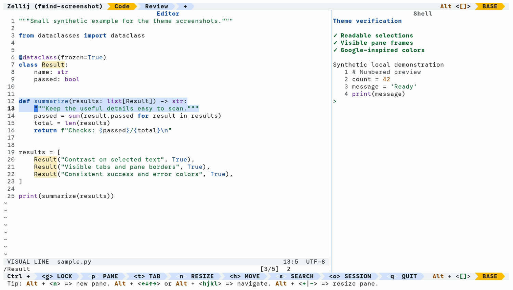
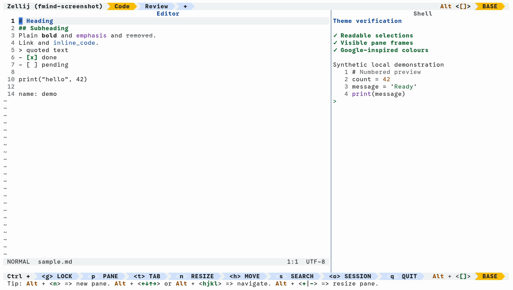
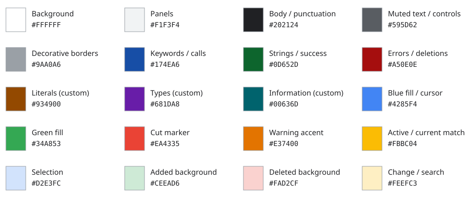

# fmind/theme

The Fmind design system and light theme: one palette for terminals, editors, coding agents, sites, charts and diagrams. [DESIGN.md](DESIGN.md) describes the design for agents and design tools; native files live in one folder per tool under `themes/`.

[Previews](#previews) · [Design system](#design-system) · [Palette](#palette) · [Themes](#available-themes) · [Contribute](#contribute)

[Changelog](CHANGELOG.md) · [Previous releases](https://github.com/fmind/theme/releases)

## Previews

| Code, shell, search and selection                    | Markdown                                        |
| ---------------------------------------------------- | ----------------------------------------------- |
|  |  |

Synthetic terminal captures made with VHS. Download [wallpapers](wallpapers/README.md) and [social banners](banners/README.md), or [preview all artwork](artworks/previews/all-variants.png).

## Design system

[DESIGN.md](DESIGN.md) is the single source for Fmind's visual identity: color roles, typography, layout, shapes, components, charts and do's and don'ts. It follows the [DESIGN.md format](https://github.com/google-labs-code/design.md) (alpha): YAML design tokens followed by prose rationale. Edit it here; consumers read it or use a ready-made file instead of copying values.

| For                           | Use                                                                                                                                                       |
| ----------------------------- | --------------------------------------------------------------------------------------------------------------------------------------------------------- |
| A coding agent                | DESIGN.md itself. [fmind/dot](https://github.com/fmind/dot) deploys a checksummed copy to `~/.agents/DESIGN.md`, and its shared `AGENTS.md` points to it. |
| A web page or rendered HTML   | [CSS custom properties](themes/css/), or the [Tailwind CSS](themes/tailwind/) and [daisyUI](themes/daisyui/) themes.                                      |
| A documentation site          | The [Zensical](themes/zensical/) stylesheet, which also fits Material for MkDocs.                                                                         |
| Highlighted code on a page    | [Pygments](themes/pygments/), [highlight.js](themes/highlightjs/) or [Prism](themes/prism/).                                                              |
| A diagram                     | The [D2](themes/d2/) import or the [Mermaid](themes/mermaid/) configuration.                                                                              |
| A chart                       | The [Matplotlib](themes/matplotlib/) style sheet or the [Streamlit](themes/streamlit/) theme.                                                             |
| A terminal recording          | The [VHS](themes/vhs/) theme tape.                                                                                                                        |
| Figma variables, other tokens | `npx @google/design.md@0.4.0 export --format dtcg DESIGN.md` emits [W3C Design Tokens](https://www.designtokens.org/) JSON.                               |
| Logos, banners, wallpapers    | The approved [artwork](artworks/README.md), [social banners](banners/README.md) and [wallpapers](wallpapers/README.md), copied unchanged.                 |

The CSS and Tailwind files are generated from DESIGN.md with `mise run tokens`. Validate a design change with `mise run check:design`, which fails on any lint warning or stale generated file, and compare revisions with `npx @google/design.md@0.4.0 diff old.md DESIGN.md`.

## Palette

The palette uses the 15 [Google News hex colors](https://partnermarketinghub.withgoogle.com/brands/google-news/visual-identity/color-palette/) plus five complementary colors. Dark shades carry text, pale shades provide surfaces, and bright shades identify active states. Text stays upright; bold adds emphasis.

| Color                | Hex       | Syntax and text                             | Interface and backgrounds                                         |
| -------------------- | --------- | ------------------------------------------- | ----------------------------------------------------------------- |
| White                | `#FFFFFF` | Label text on dark fills                    | Main background                                                   |
| Light gray           | `#F1F3F4` | —                                           | Panels, cursor line and neutral diffs                             |
| Gray                 | `#9AA0A6` | —                                           | Decorative borders and separators                                 |
| Dark gray (custom)   | `#595D62` | Comments, gutter numbers and secondary text | Essential control borders and scrollbar thumbs; ANSI bright black |
| Charcoal             | `#202124` | Body text, variables and punctuation        | Labels on bright fills; ANSI black/white                          |
| Dark blue            | `#174EA6` | Keywords, functions, keys and headings      | Navigation and links; ANSI blue                                   |
| Medium blue          | `#4285F4` | —                                           | Cursor and active label fills                                     |
| Light blue           | `#D2E3FC` | —                                           | Selections, completions and inactive ribbons                      |
| Dark red             | `#A50E0E` | Errors and deleted text                     | Failures and deletions; ANSI red                                  |
| Medium red           | `#EA4335` | —                                           | Cut markers and error underlines                                  |
| Light red            | `#FAD2CF` | —                                           | Deletion backgrounds                                              |
| Dark orange (custom) | `#934900` | Numbers, constants and warnings             | Changes and attention; ANSI yellow                                |
| Orange               | `#E37400` | —                                           | Warning accents                                                   |
| Yellow               | `#FBBC04` | —                                           | Active tabs, current search matches and changed words             |
| Light yellow         | `#FEEFC3` | —                                           | Change backgrounds and ordinary search matches                    |
| Dark green           | `#0D652D` | Strings and added text                      | Success, additions and executables; ANSI green                    |
| Medium green         | `#34A853` | —                                           | Mode labels, copy markers and success accents                     |
| Light green          | `#CEEAD6` | —                                           | Addition backgrounds                                              |
| Purple (custom)      | `#681DA8` | Types, builtins, decorators and hints       | Secondary accents; ANSI magenta                                   |
| Teal (custom)        | `#00636D` | Informational diagnostics                   | Information and icons; ANSI cyan                                  |

## Available themes

Choose a tool for installation instructions and theme files. Each README cites the upstream format its files follow. The catalog covers the tools [fmind/dot](https://github.com/fmind/dot) deploys, the renderers Fmind projects publish with, and leading alternatives for developers on Linux and macOS.

### Terminals

- [Alacritty](themes/alacritty/)
- [Ghostty](themes/ghostty/)
- [iTerm2](themes/iterm2/)
- [Kitty](themes/kitty/)
- [Prompt](themes/iterm2/#prompt)
- [Terminal.app](themes/terminal-app/)
- [Termux](themes/termux/)
- [tmux](themes/tmux/)
- [Warp](themes/warp/)
- [WezTerm](themes/wezterm/)
- [Zellij](themes/zellij/)

### Shell and command-line tools

- [Atuin](themes/atuin/)
- [bat](themes/bat/)
- [btop](themes/btop/)
- [delta](themes/delta/)
- [dircolors](themes/dircolors/)
- [DuckDB](themes/duckdb/)
- [eza](themes/eza/)
- [Fastfetch](themes/fastfetch/)
- [Fish](themes/fish/)
- [fzf](themes/fzf/)
- [Git](themes/git/)
- [GitHub CLI](themes/glamour/#github-cli)
- [Glamour](themes/glamour/)
- [GNU grep](themes/grep/)
- [k9s](themes/k9s/)
- [Lazydocker](themes/lazydocker/)
- [LazyGit](themes/lazygit/)
- [lsd](themes/lsd/)
- [man pages](themes/man-pages/)
- [pgcli](themes/pgcli/)
- [ripgrep](themes/ripgrep/)
- [Starship](themes/starship/)
- [Yazi](themes/yazi/)
- [zsh-syntax-highlighting](themes/zsh-syntax-highlighting/)

### Editors

- [Cursor](themes/vscode/#cursor)
- [Helix](themes/helix/)
- [JetBrains](themes/jetbrains/)
- [lualine](themes/lualine/)
- [Neovim](themes/nvim/)
- [Vim](themes/vim/)
- [VS Code](themes/vscode/)
- [Zed](themes/zed/)

### Coding agents

- [Claude Code](themes/claude-code/)
- [Hermes Agent](themes/hermes-agent/)
- [OpenCode](themes/opencode/)
- [Pi Coding Agent](themes/pi-coding-agent/)
- [T3 Code](themes/t3code/)

### Sites and documentation

- [CSS](themes/css/)
- [daisyUI](themes/daisyui/)
- [Django Admin](themes/django-admin/)
- [highlight.js](themes/highlightjs/)
- [Material for MkDocs](themes/zensical/#material-for-mkdocs)
- [Prism](themes/prism/)
- [Pygments](themes/pygments/)
- [Starlight](themes/astro-starlight/)
- [Tailwind CSS](themes/tailwind/)
- [Zensical](themes/zensical/)

### Data, diagrams and recordings

- [D2](themes/d2/)
- [JupyterLab](themes/jupyterlab/)
- [Matplotlib](themes/matplotlib/)
- [Mermaid](themes/mermaid/)
- [Streamlit](themes/streamlit/)
- [VHS](themes/vhs/)

### Browsers and interchange

- [Base16](themes/base16/)
- [Chrome](themes/chrome/)
- [Microsoft Edge](themes/chrome/#microsoft-edge)
- [Vivaldi](themes/chrome/#vivaldi)

For a tool without a port, start from the [Base16](themes/base16/) scheme or the palette above. Ports removed from the catalog remain available in [previous releases](https://github.com/fmind/theme/releases).

## Contribute

Edit native files under `themes/` directly. A port is kept or added only when fmind/dot deploys it, a Fmind project renders with it, or it is a leading developer, data or AI tool on Linux or macOS; consumer apps, desktop environments, website userstyles, Windows-only apps, variants of existing ports and ports that need dependencies or build steps are declined. For a new or corrected port, add a `Format:` line to its README that links the upstream format or loader, document installation in that README, add its directory to the matching list above in alphabetical order, and test its actual colors and representative states. Report the app version and platform used; distinguish parser checks from native loading and visual testing.

Use only palette colors and keep text upright. Compute `0x` hex, decimal and Windows BGR color values carefully, because checks read only `#` hex colors. Name palette swatches with the color names above, and state the full installation destination, such as `~/.config/<app>/`, in each README.

Run `mise install` and `mise run install` to install tools and Git hooks, `mise run format` to format, then `mise run all` to validate. Checks cover repository invariants such as palette colors, file syntax and links, not native loading, so verify changed themes manually in their apps. See [maintenance](AGENTS.md#maintenance) for hooks, formatting scope and tasks; agents follow the [port procedure](.agents/skills/theme-port/SKILL.md).

Releases use immutable annotated tags and source archives; maintainers follow the [release procedure](.agents/skills/theme-release/SKILL.md). Maintained alongside [fmind/dot](https://github.com/fmind/dot). [MIT license](LICENSE); bundled Google Sans retains its [OFL license](artworks/OFL.txt).
