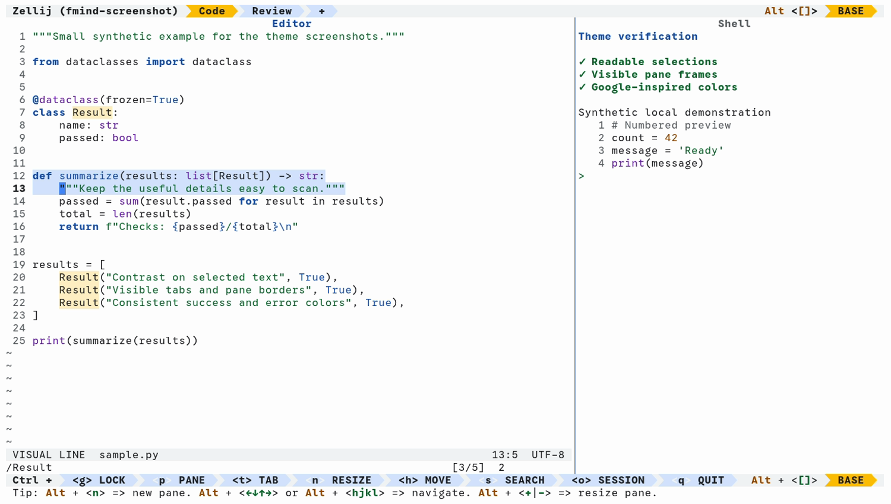
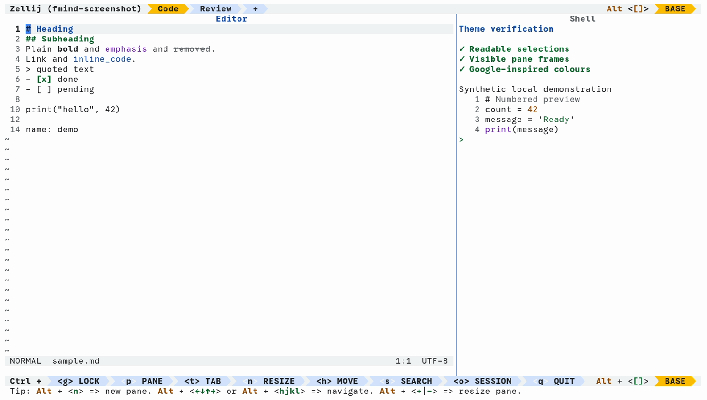
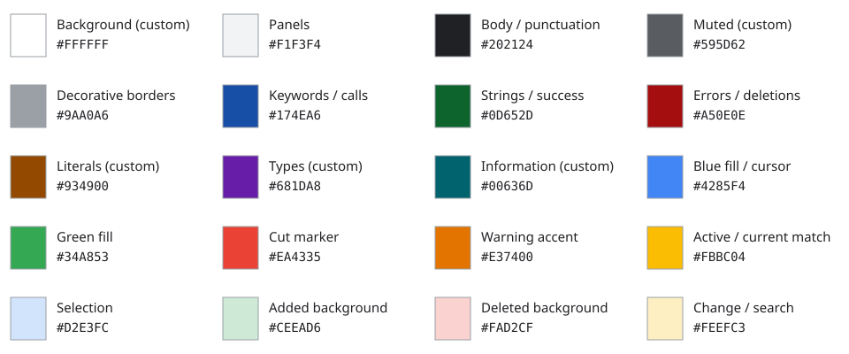

# fmind/theme

  

Light-only design system and native theme catalog for Linux and macOS terminals, editors, coding agents, sites, charts and diagrams. Copy any native file under `themes/` with zero build steps or dependencies, or drop [fmind.css](themes/css/fmind.css) or [DESIGN.md](DESIGN.md) into a project.

[Previews](#previews) · [Design system](#design-system) · [Palette](#palette) · [Themes](#available-themes) · [Contribute](#contribute) · [Changelog](CHANGELOG.md)

## Previews

| Code, shell, search and selection                    | Markdown                                        |
| ---------------------------------------------------- | ----------------------------------------------- |
|  |  |

Synthetic terminal captures made with VHS. Download [wallpapers](wallpapers/README.md) and [social banners](banners/README.md), or [preview all artwork](artworks/previews/all-variants.png).

## Design system

[DESIGN.md](DESIGN.md) is the single source for Fmind's visual identity: color roles, typography, layout, shapes, components, charts and do's and don'ts. It follows the [DESIGN.md format](https://github.com/google-labs-code/design.md) (alpha): YAML design tokens followed by prose rationale. Edit it here; consumers read it or use a ready-made file instead of copying values.

| For                           | Use                                                                                                                                                       |
| ----------------------------- | --------------------------------------------------------------------------------------------------------------------------------------------------------- |
| A coding agent                | DESIGN.md itself. [fmind/dot](https://github.com/fmind/dot) deploys a checksummed copy to `~/.agents/DESIGN.md`, and its shared `AGENTS.md` points to it. |
| A web page or rendered HTML   | [CSS custom properties](themes/css/), or the [Tailwind CSS](themes/tailwind/) and [daisyUI](themes/daisyui/) themes.                                      |
| A documentation site          | The [Zensical](themes/zensical/) stylesheet, which also fits Material for MkDocs.                                                                         |
| Highlighted code on a page    | [Pygments](themes/pygments/), [highlight.js](themes/highlightjs/) or [Prism](themes/prism/).                                                              |
| A diagram                     | The [D2](themes/d2/) import, the [Typst](themes/typst/) module or the [Mermaid](themes/mermaid/) configuration.                                           |
| A chart                       | The [Matplotlib](themes/matplotlib/) style sheet or the [Streamlit](themes/streamlit/) theme.                                                             |
| A terminal recording          | The [VHS](themes/vhs/) theme tape.                                                                                                                        |
| Figma variables, other tokens | `npx @google/design.md@0.4.0 export --format dtcg DESIGN.md` emits [W3C Design Tokens](https://www.designtokens.org/) JSON.                               |
| Logos, banners, wallpapers    | The approved [artwork](artworks/README.md), [social banners](banners/README.md) and [wallpapers](wallpapers/README.md), copied unchanged.                 |

The CSS and Tailwind files are generated from DESIGN.md with `mise run tokens`. Validate a design change with `mise run check:design`, which fails on any lint warning or stale generated file, and compare revisions with `npx @google/design.md@0.4.0 diff old.md DESIGN.md`.

## Palette

The palette uses the 15 [Google News hex colors](https://partnermarketinghub.withgoogle.com/brands/google-news/visual-identity/color-palette/) plus five complementary colors. Dark shades carry text, pale shades provide surfaces, and bright shades identify active states. Text stays upright; bold adds emphasis.

| Color                | Hex       | Syntax and text                             | Interface and backgrounds                                         |
| -------------------- | --------- | ------------------------------------------- | ----------------------------------------------------------------- |
| White (custom)       | `#FFFFFF` | Label text on dark fills                    | Main background                                                   |
| Light gray           | `#F1F3F4` | —                                           | Panels, cursor line and neutral diffs                             |
| Gray                 | `#9AA0A6` | —                                           | Decorative borders and separators                                 |
| Dark gray (custom)   | `#595D62` | Comments, gutter numbers and secondary text | Essential control borders and scrollbar thumbs; ANSI bright black |
| Charcoal             | `#202124` | Body text, variables and punctuation        | Labels on bright fills; ANSI black/white                          |
| Dark blue            | `#174EA6` | Keywords, functions, keys and headings      | Navigation and links; ANSI blue                                   |
| Medium blue          | `#4285F4` | —                                           | Cursor and active label fills                                     |
| Light blue           | `#D2E3FC` | —                                           | Selections, completions and inactive ribbons                      |
| Dark red             | `#A50E0E` | Errors and deleted text                     | Failures and deletions; ANSI red                                  |
| Medium red           | `#EA4335` | —                                           | Cut markers and error underlines                                  |
| Light red            | `#FAD2CF` | —                                           | Deletion backgrounds                                              |
| Dark orange (custom) | `#934900` | Numbers, constants and warnings             | Changes and attention; ANSI yellow                                |
| Orange               | `#E37400` | —                                           | Warning accents                                                   |
| Yellow               | `#FBBC04` | —                                           | Active tabs, current search matches and changed words             |
| Light yellow         | `#FEEFC3` | —                                           | Change backgrounds and ordinary search matches                    |
| Dark green           | `#0D652D` | Strings and added text                      | Success, additions and executables; ANSI green                    |
| Medium green         | `#34A853` | —                                           | Mode labels, copy markers and success accents                     |
| Light green          | `#CEEAD6` | —                                           | Addition backgrounds                                              |
| Purple (custom)      | `#681DA8` | Types, builtins, decorators and hints       | Secondary accents; ANSI magenta                                   |
| Teal (custom)        | `#00636D` | Informational diagnostics                   | Information and icons; ANSI cyan                                  |

## Available themes

Choose a tool for installation instructions and theme files. Each README cites the upstream format its files follow. The catalog covers the tools [fmind/dot](https://github.com/fmind/dot) deploys, the renderers Fmind projects publish with, and leading alternatives for developers on Linux and macOS.

### Terminals

- [Alacritty](themes/alacritty/)
- [Ghostty](themes/ghostty/)
- [iTerm2](themes/iterm2/)
- [Kitty](themes/kitty/)
- [Prompt](themes/iterm2/README.md#prompt)
- [Terminal.app](themes/terminal-app/)
- [tmux](themes/tmux/)
- [Warp](themes/warp/)
- [WezTerm](themes/wezterm/)
- [Zellij](themes/zellij/)

### Shell and command-line tools

- [Atuin](themes/atuin/)
- [bat](themes/bat/)
- [btop](themes/btop/)
- [delta](themes/delta/)
- [dircolors](themes/dircolors/)
- [DuckDB](themes/duckdb/)
- [eza](themes/eza/)
- [Fastfetch](themes/fastfetch/)
- [fd](themes/dircolors/README.md#fd)
- [Fish](themes/fish/)
- [fzf](themes/fzf/)
- [Git](themes/git/)
- [GitHub CLI](themes/glamour/README.md#github-cli)
- [Glamour](themes/glamour/)
- [GNU grep](themes/grep/)
- [jq](themes/jq/)
- [k9s](themes/k9s/)
- [Lazydocker](themes/lazydocker/)
- [LazyGit](themes/lazygit/)
- [lsd](themes/lsd/)
- [man pages](themes/man-pages/)
- [pgcli](themes/pgcli/)
- [ripgrep](themes/ripgrep/)
- [Starship](themes/starship/)
- [Yazi](themes/yazi/)
- [zsh-syntax-highlighting](themes/zsh-syntax-highlighting/)

### Editors

- [Cursor](themes/vscode/README.md#cursor)
- [Helix](themes/helix/)
- [JetBrains](themes/jetbrains/)
- [lualine](themes/lualine/)
- [Neovim](themes/nvim/)
- [Vim](themes/vim/)
- [VS Code](themes/vscode/)
- [Zed](themes/zed/)

### Coding agents

- [Antigravity](themes/vscode/README.md#antigravity)
- [Claude Code](themes/claude-code/)
- [GitHub Copilot CLI](themes/copilot/)
- [Hermes Agent](themes/hermes-agent/)
- [OpenCode](themes/opencode/)
- [Pi Coding Agent](themes/pi-coding-agent/)
- [T3 Code](themes/t3code/)

### Sites and documentation

- [CSS](themes/css/)
- [daisyUI](themes/daisyui/)
- [Django Admin](themes/django-admin/)
- [highlight.js](themes/highlightjs/)
- [Material for MkDocs](themes/zensical/README.md#material-for-mkdocs)
- [Prism](themes/prism/)
- [Pygments](themes/pygments/)
- [Starlight](themes/astro-starlight/)
- [Tailwind CSS](themes/tailwind/)
- [Zensical](themes/zensical/)

### Data, diagrams and recordings

- [D2](themes/d2/)
- [JupyterLab](themes/jupyterlab/)
- [Matplotlib](themes/matplotlib/)
- [Mermaid](themes/mermaid/)
- [Streamlit](themes/streamlit/)
- [Typst](themes/typst/)
- [VHS](themes/vhs/)

### Browsers and interchange

- [Base16](themes/base16/)
- [Chrome](themes/chrome/)
- [Microsoft Edge](themes/chrome/README.md#microsoft-edge)
- [Vivaldi](themes/chrome/README.md#vivaldi)

For a tool without a port, start from the [Base16](themes/base16/) scheme or the palette above. Ports removed from the catalog remain available in [previous releases](https://github.com/fmind/theme/releases).

## Contribute

Edit native files under `themes/` directly using only palette colors and upright text. Ports are accepted when [fmind/dot](https://github.com/fmind/dot) deploys them, a Fmind project renders with them, or they serve leading Linux/macOS developer, data or AI tools with zero dependencies or build steps.

Run `mise install && mise run install`, format with `mise run format`, and validate with `mise run all`. Automated checks cover `#` hex, ANSI SGR, syntax and links, not native app rendering or non-`#` color encodings; test changed ports in the real tool.

See [AGENTS.md](AGENTS.md) for invariants and tasks, the [port workflow](.agents/skills/theme-port/SKILL.md) for adding or fixing ports, and the [release procedure](.agents/skills/theme-release/SKILL.md) for immutable releases.

Maintained alongside [fmind/dot](https://github.com/fmind/dot). [MIT license](LICENSE); bundled Google Sans retains its [OFL license](artworks/OFL.txt). Report security issues via the [security policy](https://github.com/fmind/theme/security/policy).
